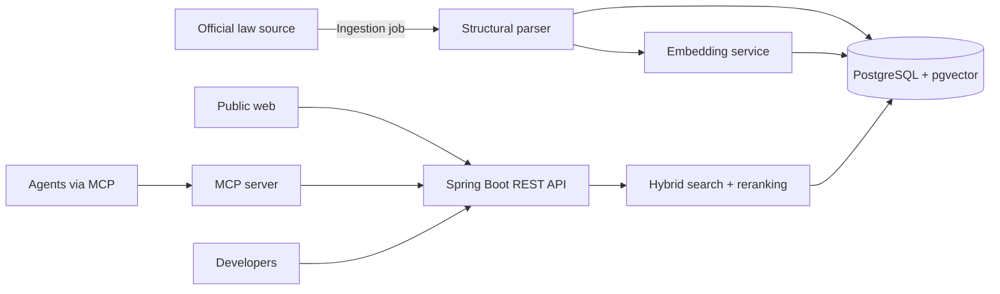

# LeyAPI

A public API and [MCP](https://modelcontextprotocol.io) server for searching Mexican federal legislation, designed so that any LLM or agent can do RAG over the **exact articles**, their **currently valid version**, and their **official source**.

> **Disclaimer:** this project provides legal information, not legal advice.

> **Status:** early development. Nothing here is stable yet, and the name is tentative.

## Why

- LLMs hallucinate articles, cite outdated versions, or invent article numbers when answering questions about Mexican law.
- There is no open benchmark to measure how well Mexican legislation is retrieved.

LeyAPI aims to return the relevant articles with verifiable metadata (law, article, fraction, reform date, official link), and to publish a reproducible eval that shows with numbers how well retrieval works.

## Planned features

- Structure-aware ingestion of federal laws (law > title > chapter > article > fraction).
- Hybrid search (full-text + semantic) with filters by law and date.
- Temporal versioning: what did an article say on a given date?
- Cross-reference resolution between articles.
- REST API with free API keys and rate limiting.
- MCP server so agents can search and fetch articles directly.
- Public, reproducible retrieval eval (Recall@k, MRR, nDCG).

## Architecture



## Tech stack

- Java 21, Spring Boot 4.1
- PostgreSQL + pgvector (vector search) + full-text search
- Flyway (migrations)
- Docker Compose (local development)
- JUnit 5 and Testcontainers (testing)

## Project structure

The code is organized in four modules, one package each, under `com.example.LeyesAPI`:

| Package | Responsibility |
|---|---|
| `ingestion` | Downloading, parsing, and storing laws |
| `search` | Full-text, vector, and hybrid retrieval |
| `api` | Public REST API |
| `mcp` | MCP server exposing search and lookup tools |

## Getting started

Prerequisites: JDK 21 and Docker.

Start PostgreSQL with pgvector:

```bash
docker compose up -d
```

It works out of the box with local development defaults. To override them (database name, user, password, port), copy the example file and edit it:

```bash
cp .env.example .env
```

Then run the application (Spring Boot also starts the Compose services automatically if they are not running):

```bash
./mvnw spring-boot:run
```

To run the whole stack (database + application) in containers instead:

```bash
docker compose up --build
```

The health endpoint is then available at <http://localhost:8080/actuator/health>.

## License

To be decided.
